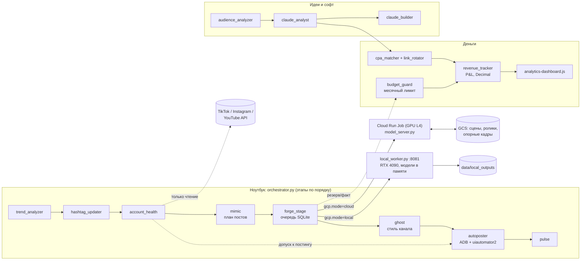

# Прометей — конвейер коротких видео

Генерация роликов (Wan 2.2 TI2V-5B + XTTS v2) → план публикаций → подготовка под площадки →
публикация на телефонах → учёт аккаунтов, бюджета и экономики. Оркестрация — Python на ноутбуке,
генерация — Cloud Run Job с GPU L4 или (с 8–9 месяца) свой RTX 4090 через `local_worker`.

Статус: тесты на моках зелёные (pytest 314, jest 39), с реальными API площадок, Cloud Run и GPU
код этого репозитория **не запускался** — см. «Что проверено, а что нет» в конце.

---

## Архитектура



| Модуль | Что делает |
|---|---|
| `orchestrator.py` | Полный цикл: `trend_analyzer → hashtag_updater → account_health → mimic → forge → ghost → autoposter → pulse` |
| `forge.py` | Сценарий (LLM или шаблоны), сцены, персона и seed лица; выбирает облако или локальный GPU по `gcp.mode` |
| `forge_stage.py` + `job_queue.py` | Очередь задач генерации в SQLite: повторы, приоритет новых аккаунтов, `--resume`, остановка по доле падений и по бюджету |
| `model_server.py` | Генерация внутри Cloud Run Job / HTTP-сервер / вызов из `local_worker`; хранилище `gcs` или `local` |
| `local_worker.py`, `run_generation_local.py` | Свой GPU: очередь, проверка VRAM, повтор при OOM с меньшим числом кадров, API `/submit /status /result /health` |
| `mimic.py`, `diversity.py` | План постов: уникальные хуки, хэштеги, CTA внутри ниши |
| `ghost.py` | Финальный рендер 1080×1920 в фирменном стиле канала (цвет, сила, кадрирование) |
| `autoposter.py` | Публикация через ADB; пускает только аккаунты `active` в пределах дневного лимита |
| `account_health.py` | Статусы аккаунтов, прогрессия постов, проверка охвата (shadowban) и бана через официальные API |
| `budget_guard.py` | Месячный лимит расходов на Cloud Run GPU |
| `revenue_tracker.py`, `analytics-dashboard.js` | P&L по месяцам до цента, прогноз, реинвест-план, HTML-панель |
| `cpa_matcher.py`, `link_rotator.py`, `advertising.py` | Подбор CPA-оффера, UTM-ссылки с erid, маркировка рекламы в плане и при публикации |
| `audience_analyzer.py`, `claude_analyst.py`, `claude_builder.py` | Комментарии → темы и вопросы (Claude) → однофайловые утилиты (с проверкой кода, без запуска) |
| `fan-memory.js`, `emotional-memory.js`, `chat-integration.js`, `affiliate-tracker.js`, `cross-promo.js` | JS-часть: память фанатов, Fanvue/Anlora, партнёрские ссылки, кросс-промо |

### Чего нет в репозитории

Код этих модулей есть у владельца проекта, но в репозиторий не передавался. Без них
соответствующие этапы не запустятся:

| Файл | Где нужен |
|---|---|
| `run_generation_gcp.py` | `forge` в режиме `gcp.mode=cloud` (загрузка сцен в GCS, запуск Job через `gcp_client`) |
| `trends_collector.py`, `trend_analyzer.py`, `hashtag_updater.py`, `stock_fetcher.py` | Этапы трендов в `orchestrator` |
| `pulse.py`, `web_panel.py` | Этап `pulse`, веб-панель запуска |
| `requirements-gpu.txt` | `make build` (Dockerfile) |
| `ppv-funnel.js`, `retention-engine.js`, `price-ab-tester.js`, `scheduler` | JS-часть монетизации (упомянуты в `CHANGES.md`) |

---

## Быстрый старт

```bash
cd farm && make install                                  # 1. зависимости (Python 3.10+, Node 18+)
cp devices.example.json devices.json && cp niches.example.json niches.json   # 2. устройства и ниши
cp .env.example .env && $EDITOR config.json .env    # 3. проект GCP, ключи (таблица ниже)
make test && make lint                                   # 4. всё зелёное на моках
python orchestrator.py --dry-run                         # 5. план цикла без генерации и публикации
```

Дальше: `python orchestrator.py --parallel` (полный цикл), `python orchestrator.py --script forge --resume`
(доделать очередь после сбоя), `python revenue_tracker.py --month 2026-01 --format table`.

Коды выхода `orchestrator.py`: `0` — все этапы ok, `1` — были ошибки, `2` — неверные аргументы,
`3` — forge остановлен (окончательно упало > 20 % задач), `130` — прерван Ctrl+C (очередь сохранена).

---

## Переменные окружения

Секреты — только в окружении (или `.env` рядом с `config.json`, его подхватывает `config_loader`).
В логи значения не пишутся.

| Переменная | Кто читает | Обязательна | Назначение |
|---|---|---|---|
| `GCP_PROJECT_ID` | config_loader | для `gcp.mode=cloud`, если нет в config.json | Проект GCP |
| `GCP_REGION`, `GCP_JOB_NAME`, `GCS_WORK_BUCKET`, `GCS_MODELS_BUCKET` | config_loader, download_models.sh | нет | Переопределяют `gcp.*` из config.json |
| `GCP_BILLING_ACCOUNT` | budget_guard `--print-gcp-budget-cmd` | нет | Платёжный аккаунт для команды бюджета GCP |
| `TOGETHER_API_KEY` | forge | нет | LLM-сценарии; без него — шаблоны и хуки из плана mimic |
| `ANTHROPIC_API_KEY` | claude_analyst, claude_builder | для этих модулей | Claude API (модель `claude-sonnet-5-5`) |
| `APIFY_API_TOKEN` | orchestrator → trend_analyzer | для этапа трендов | Сбор трендов |
| `YOUTUBE_API_KEY` | account_health, trends_collector | для проверки YouTube | YouTube Data API v3 |
| `TIKTOK_TOKEN_<DEVICE_ID>` | account_health | для проверки TikTok | User token TikTok Display API; `<DEVICE_ID>` в верхнем регистре, `-` → `_` |
| `INSTAGRAM_TOKEN_<DEVICE_ID>` | account_health | для проверки Instagram | Токен Instagram Graph API |
| `LOCAL_WORKER_TOKEN` | local_worker, run_generation_local | для `gcp.mode=local` | Bearer-токен API воркера (одинаковый на обеих сторонах) |
| `MODEL_SERVER_TOKEN` | model_server `--serve` | для HTTP-режима | Bearer-токен сервера генерации |
| `ALLOW_NO_AUTH` | model_server, local_worker | нет | `1` — разрешить запуск без токена (только локальная отладка) |
| `STORAGE_BACKEND` | model_server | нет | `gcs` (по умолчанию) или `local` |
| `LOCAL_STORAGE_ROOT` | model_server | нет | Корень для `STORAGE_BACKEND=local` (по умолчанию — текущая папка) |
| `MODELS_DIR` | model_server, download_models.sh | нет | Папка моделей (`/models`) |
| `WAN_STEPS`, `WAN_GUIDANCE`, `WAN_WIDTH`, `WAN_HEIGHT`, `WAN_FPS`, `WAN_MAX_FRAMES`, `WAN_OFFLOAD` | model_server | нет | Параметры генерации Wan (по умолчанию 4 / 1.0 / 480 / 832 / 24 / 121 / 1) |
| `DEVICE_ID`, `SOURCE_IDX`, `SCENES_URI`, `OUTPUT_URI`, `CONCAT_URI`, `STAGE`, `VOICE_ID`, `SPLIT_SCREEN` | model_server (Cloud Run Job) | задаёт run_generation_gcp | Параметры одной задачи |
| `HOST`, `PORT` | model_server `--serve` | нет | Адрес HTTP-режима (по умолчанию `0.0.0.0:8080`) |
| `FORCE_MODEL_SYNC`, `ALLOW_MISSING_MODELS` | download_models.sh | нет | Перекачать модели / не падать без них |
| `HF_HOME`, `COQUI_TOS_AGREED` | Dockerfile | задано в образе | Кэш HuggingFace, согласие с лицензией XTTS |
| `FANVUE_TOKEN`, `FANVUE_BASE` | chat-integration.js | для Fanvue | Токен и адрес API Fanvue [ПРОВЕРИТЬ ПО ДОКАМ адрес] |
| `ANLORA_BASE_URL`, `ANLORA_API_KEY` | chat-integration.js | для Anlora | Генерация ответов в чате |
| `HTTP_TIMEOUT_MS` | chat-integration.js | нет | Таймаут HTTP (20000) |
| `PROMETHEUS_ROOT` | common.js | нет | Другой корень данных для JS (тесты, второй экземпляр) |
| `LOG_LEVEL` | config_loader, model_server | нет | `INFO` по умолчанию |

---

## Как добавить новую нишу

1. **Имя и маркер.** Выберите id вида `cooking_female` и маркер для username (например `.chef`).
2. **`niches.json`**: добавьте `"cooking_female": {"marker": ".chef", "keywords": [...], "hashtags_seed": [10+ тегов], "hooks": []}`.
   Ключевые слова нужны forge для отбора трендов, теги — mimic (сочетания по 4–5 из первых 10).
3. **`config.json`**: допишите нишу в `mimic.active_niches`, `trends_collector.active_niches`,
   `devices_registry.niche_markers` и, если нужен сбор трендов, `trend_analyzer.profiles`.
4. **Контент (код):**
   - `forge.py` — `NICHE_STYLE` (внешний вид), `FALLBACK_ACTIONS` и `FALLBACK_HOOKS` (запасной сценарий без LLM),
     `NICHE_KEYWORDS` (если не хватает ключей из niches.json);
   - `mimic.py` — `NICHE_HOOKS`, `NICHE_CTAS`, `NICHE_CTAS_RU`, `HOOK_TEMPLATES` и `HOOK_FILLERS`.
     Пул хуков должен быть ≥ (аккаунтов в нише × постов в день), иначе mimic пишет предупреждение.
5. **Проверка:** `make test` (тест `test_hooks_unique_per_day_within_niche` автоматически пройдёт по новой нише
   на en и ru), затем `python mimic.py --device <новое_устройство>` и `python forge.py --dry-run --device ...`.

## Как добавить новую модель (персонажа) и аккаунты

Одно устройство = одна модель = 3 аккаунта (TikTok, Instagram, YouTube) **одной ниши и одного типа**.

1. **`devices.json`** — новое устройство:
   `device_id` (только `[A-Za-z0-9_-]`, для CPA-ссылок лучше без `-`), `niche`, `model_name`,
   `adb: {host, port}`, `voice_id`, `accounts.{tiktok,instagram,youtube}.username` (с маркером ниши).
   Для проверок аккаунтов добавьте `accounts.instagram.ig_user_id`, `accounts.youtube.channel_id` и
   `created_at` (дата создания аккаунта — иначе он считается новым и 7 дней не публикует).
2. **Персона** (необязательно): `models/<device_id>/metadata.json` с `appearance`, `tone`, `lighting`,
   `persona_lock` (seed лица). Без него внешность и seed выводятся из `device_id` детерминированно.
3. **Голос**: `voice_id` из `uniqueness.voice_pool`, файл `voices/<voice_id>.wav` в бакете моделей.
4. **Токены** для account_health: `TIKTOK_TOKEN_<DEVICE_ID>`, `INSTAGRAM_TOKEN_<DEVICE_ID>`.
5. **Проверка:** `python devices_registry.py` (устройство не должно быть «отброшено»),
   `python account_health.py --device <id>`, `python orchestrator.py --dry-run --device <id>`.
6. Первая генерация создаст опорный кадр лица и закэширует его (GCS `master_ref_uri` или
   `models/masters/<device>_<persona_lock>.png` в локальном режиме) — дальше лицо не меняется.

---

## Реклама: CPA-ссылки и маркировка

Включается блоком `advertising` в config.json (по умолчанию в примере — включено).

1. **Кому.** Только устройствам с `"account_type": "entertainment"` в devices.json (список —
   `advertising.account_types`). Без поля `account_type` CPA не ставится.
2. **Офферы** — `data/cpa_offers.json` (пример: `cpa_offers.example.json`): `keywords`, `payout`, `url`,
   для маркировки — `advertiser` (наименование и ИНН рекламодателя), `erid` (токен ОРД).
3. **mimic** подбирает оффер по хуку и хэштегам слота (`cpa_matcher`), строит ссылку на каждую
   площадку (`link_rotator`, с `utm_*` и `erid`) и пишет в слот `ad` и `description`:
   «Реклама. <рекламодатель>. erid: <токен>» + ссылка. Новые поля появятся в уже существующих
   планах только после `python mimic.py --replan`.
4. **autoposter** для рекламного слота (или если в описании есть CPA-ссылка) ставит метку первой
   строкой, ссылку, хэштеги площадки (`#ad #sponsored` у TikTok) и нажимает переключатель
   площадки (Paid partnership у Instagram, Includes paid promotion у YouTube) перед публикацией.
   Не публикует, если: `require_erid=true` и erid нет; переключатель не найден
   (`require_platform_toggle=true`); метка не влезает в лимит подписи.
5. В `posted.json` у опубликованного рекламного поста сохраняется `ad` (оффер, erid, метка) —
   пригодится для отчётности перед ОРД.

[ПРОВЕРИТЬ] Тексты переключателей в приложениях (`default_ad_markers` без «#») зависят от версии
и языка интерфейса; erid по закону выдаётся на креатив, а не на оффер; состав метки и отчётность в ОРД —
по 38-ФЗ и требованиям вашего ОРД. Ссылки в подписях TikTok/Instagram обычно не кликабельны —
обычно ссылку дают в профиле (тогда маркировка нужна и там).

## Troubleshooting

| # | Симптом | Причина | Что делать |
|---|---|---|---|
| 1 | `local_worker`: «нехватка VRAM при max_frames=121 — повтор с 81», затем «окончательно» | CUDA OOM на 4090 | Лесенка `local.oom_max_frames` уже понижает кадры. Если падает и на 49: `WAN_OFFLOAD=1`, меньше `WAN_WIDTH/HEIGHT`, закрыть другие процессы на GPU (`nvidia-smi`) |
| 2 | `мало видеопамяти: свободно N МБ < 2000 МБ — жду` | GPU занят другим процессом | Освободить GPU или уменьшить `local.vram_safety_mb` |
| 3 | `Claude API: лимит запросов (повторы SDK исчерпаны)` / HTTP 429 | Rate limit Anthropic, Fanvue и т.п. | SDK уже повторил 3 раза с паузой; запустить позже или снизить частоту. Для Fanvue `chat-integration.js` учитывает `retry-after` |
| 4 | `Claude отказался выполнить запрос (категория: …)` | Классификатор безопасности (`stop_reason=refusal`) | Посмотреть входные комментарии/идею; fallback уже включён для `cyber`/`frontier_llm` |
| 5 | `account=tiktok БАН по ответу API` / статус `banned` | API площадки ответил «suspended» и т.п. | Проверить аккаунт вручную. Статус «липкий»: вернуть — `python account_health.py --set aria_fight:tiktok:active` |
| 6 | `shadowban_suspect … публикация на паузе` | Средние просмотры созревших постов < 50 | Разобраться с контентом; пауза снимется сама, когда охват вырастет выше порога |
| 7 | `нет учётных данных … TIKTOK_TOKEN_ARIA_FIGHT` | Не задан токен площадки | Задать переменную; без неё проверки охвата/бана для аккаунта пропускаются |
| 8 | `ANTHROPIC_API_KEY не задан` / `задай LOCAL_WORKER_TOKEN` | Нет секрета | Задать в окружении или `.env` |
| 9 | forge: код 4, «лимит бюджета исчерпан» | Потрачен `budget.monthly_limit_usd` | Ждать новый месяц биллинга или `python forge_stage.py --resume --reset-budget` (осознанно!) |
| 10 | forge: код 3, «окончательно упало … > 20%» | Массовые падения генерации | `jobs.error` в `data/queue.db`; после исправления — `python orchestrator.py --script forge --resume` |
| 11 | `autoposter`: «не найдена кнопка …» | Изменился интерфейс приложения/язык телефона | Скриншот в `logs/autoposter_screens/`; поправить `autoposter.flows` в config.json |
| 12 | `ошибки в конфиге: …` при старте | Неверное значение в config.json | Текст ошибки называет ключ; допустимые значения — в `config_loader.py` |
| 13 | `оркестратор уже запущен (lock: …)` | Второй запуск из cron | Дождаться первого; при зависании — проверить процесс, удалить `logs/orchestrator.lock` |

---

## Экономика

`python revenue_tracker.py --month 2026-01 --format table` считает P&L (Decimal, до цента) и пишет
`data/analytics/pnl_2026-01.json`; `node analytics-dashboard.js` рисует `data/analytics/dashboard.html`.

Входные данные — `data/cpa_stats.json`, `data/software_sales.json`, `data/expenses.json` (форматы — в
начале `revenue_tracker.py`), стоимость GPU — из `budget_guard` или фактического счёта GCP.

### Строки P&L

| Строка | Откуда | Пример |
|---|---|---|
| CPA (подтверждённые) | `cpa_stats.json`, `status=approved` | $3,200.00 |
| − комиссия CPA-сети | `economics.cpa_commission` × CPA по аккаунту | −$0.00 |
| Продажи софта | `software_sales.json` без возвратов | $1,240.00 |
| − сборы платёжки | `fees_usd` продаж | −$48.36 |
| **Валовая − комиссии** | | **$4,391.64** |
| − GCP | счёт из `expenses.json` (`category=gcp`) или оценка `budget_guard` | −$135.00 |
| − прочие расходы | `expenses.json` (облачные телефоны, LLM, …) | −$420.00 |
| **Чистыми** | | **$3,836.64** |
| Реинвест-план | чистыми ÷ `new_account_cost` ($40), но ≤ `accounts_per_month_cap` (8) | «можно запустить 95, потолок 8/мес -> запускаем 8» |

Цифры в колонке «Пример» иллюстративные. Первый год 100 % чистыми реинвестируется
(доля владельца со второго года в расчёт пока не заложена).

### Когда покупать свой GPU

Облако: `cost_per_gpu_hour` = $0.672/ч только за L4 [ПРОВЕРИТЬ прайс Cloud Run; CPU и память
инстанса — отдельно]. Сколько часов в месяц: ролики/день × минуты GPU на ролик × 30 / 60.

| Ролики в день | Мин GPU на ролик | Часов GPU в месяц | Облако (только GPU) |
|---|---|---|---|
| 20 | 6 | 60 | ≈ $40 |
| 60 | 6 | 180 | ≈ $121 |
| 60 | 12 | 360 | ≈ $242 |
| 120 | 12 | 720 | ≈ $484 |

Свой RTX 4090 окупается за `цена_карты_и_сборки / (облако_в_месяц − электричество_в_месяц)` месяцев;
электричество ≈ мощность (≈0,45–0,6 кВт под нагрузкой) × часы × тариф [цены — ПРОВЕРИТЬ на момент покупки].
Правило проекта: когда облако стабильно выше `economics.gpu_cloud_threshold_usd` ($300/мес), P&L
выводит предупреждение — это сигнал считать переход. Переход — одна настройка `gcp.mode=local`
(см. `local_worker.py`; перед переходом скопировать опорные кадры лиц из GCS в `models/masters/`).

---

## Тесты и CI

```bash
make test     # pytest (314) + jest (39)
make lint     # ruff + mypy + node --check
```

CI (`.github/workflows/ci.yml`): Python 3.10 — ruff, mypy, pytest (с ffmpeg и Node для отдельных
тестов); Node 18 — `node --check`, jest. Секреты не нужны: GCP, Anthropic, площадки, ADB и GPU в
тестах подменены моками.

| Файл | Что проверяет |
|---|---|
| `tests/test_diversity.py` | Уникальность хуков/тегов/стилей/лиц в нише (30 аккаунтов × 7 дней), рендер ghost в ffmpeg |
| `tests/test_queue.py` | Очередь: повторы, порог падений, приоритет, атомарный захват, Ctrl+C и `--resume` |
| `tests/test_account_health.py` | Статусы, прогрессия, shadowban и бан по ответам API, интеграция с mimic/autoposter/forge |
| `tests/test_cpa.py` | Подбор оффера, UTM-ссылки, валидация |
| `tests/test_orchestrator.py` | Порядок этапов, коды выхода forge |
| `tests/test_analysis.py` | Сбор комментариев (мок ADB), Claude analyst/builder (моки и настоящий SDK с MockTransport) |
| `tests/test_budget_guard.py` | Лимит, резервы, смена месяца, пауза очереди, статус Cloud Run на настоящих protobuf |
| `tests/test_local_worker.py` | Воркер: VRAM, OOM-лесенка, мягкая остановка, API, локальное хранилище, переключение режимов |
| `tests/test_pnl.py` | P&L до цента против ручного расчёта, прогноз, реинвест, панель через Node |
| `tests/test_advertising.py` | CPA в плане, маркировка «Реклама»/erid/хэштеги, переключатель площадки, запрет публикации без erid |
| `tests/test_edge_cases.py` | Граничные случаи (атомарная запись при сбое, реестр, `run_job` без статуса, ссылки) |
| `tests/js/*.test.js` | common, fan-memory, emotional-memory, affiliate-tracker, cross-promo, chat-integration, analytics-dashboard |

## Деплой генератора (Cloud Run Job)

1. Положить `requirements-gpu.txt` (нет в репозитории), затем `make build`.
2. Один раз создать Job с GPU в Console или gcloud [ПРОВЕРИТЬ ПО ДОКАМ флаги GPU для Cloud Run Jobs и квоту L4 в регионе].
3. Обновлять образ: `make deploy CONFIRM=yes` (push в Artifact Registry + `gcloud run jobs update`).
4. Бюджет и оповещения GCP — инструкция в начале `budget_guard.py`.

## Что проверено, а что нет

- **Проверено:** вся логика на моках (pytest на Python 3.10 и 3.13, jest), ffmpeg-фильтры ghost,
  мягкая остановка `local_worker` под настоящим uvicorn, повторы Anthropic SDK через MockTransport,
  статус Cloud Run на настоящих объектах `google-cloud-run`.
- **Не проверено:** реальные Cloud Run Job и GPU, загрузка моделей Wan/XTTS, ответы API TikTok /
  Instagram / YouTube / Fanvue / Anlora (эндпоинты помечены `[ПРОВЕРИТЬ ПО ДОКАМ]` в коде),
  тексты кнопок приложений в autoposter, селекторы UI в audience_analyzer.
- **Правила площадок:** публикация и сбор через автоматизацию интерфейса телефона могут нарушать
  условия площадок; надёжнее официальные API. Пометка AI-контента включена (`monetization.disclosure`);
  рекламные посты маркируются автоматически (раздел «Реклама»), но проверку требований закона и ОРД это не заменяет.
